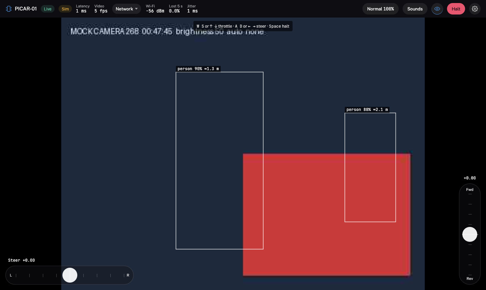
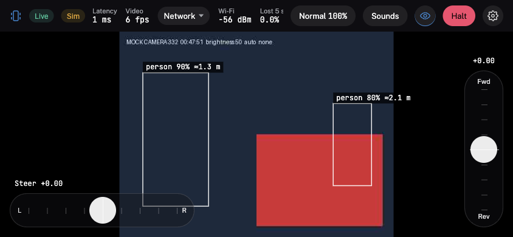
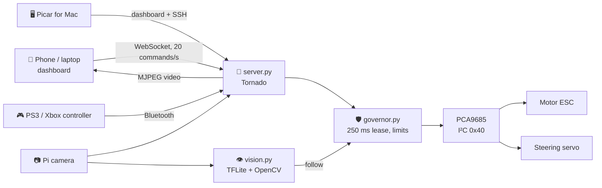

<div align="center">


**A Raspberry Pi RC car you drive from your phone: live video, a PS3 or Xbox controller, and on-board object following.**

<!-- readme-gen:start:badges -->


<!-- readme-gen:end:badges -->

<!-- readme-gen:start:tech-stack -->
<p align="center">
  
</p>
<!-- readme-gen:end:tech-stack -->

</div>

> An old Donkey Car, rebuilt as a phone-controlled car instead of a self-driving one. Open a link on any phone or
> laptop on the same Wi-Fi and you get live video and touch controls, with 11–18 ms of latency. The car can see people and
> things around it, tell roughly how far away they are, and follow the one you tap. Everything runs on the Pi
> itself, with no cloud, no account and no subscription.

<p align="center">
  
  
  <br/><sub>Laptop and phone views, shown in mock mode: a simulated camera and two simulated people.</sub>
</p>


## Highlights

<table>
<tr>
<td width="50%" valign="top">

### 📱 Drive from any browser
Live camera, a steering track and a throttle track on a phone, or WASD and the arrow keys on a laptop. Hold a spot
on the video and the car steers toward it at a crawl. One driver at a time; everyone else watches, and anyone can hit **Halt**.

</td>
<td width="50%" valign="top">

### 🛡️ Fails safe
Every command expires after 250 ms, so a dropped phone or Wi-Fi gap puts the car in neutral. The motor driver is
re-checked every second, a systemd watchdog restarts the software if it hangs, and neutral is written on every stop or crash.

</td>
</tr>
<tr>
<td width="50%" valign="top">

### 👁️ Sees and follows
Object detection on the Pi (80 everyday classes, about 4 fps on a Pi 3B), rough distances, and colour tracking.
Tap a box on the video to make the car follow that one person or thing, at a capped speed. An obstacle brake
stops forward driving when a person or object is close ahead.

</td>
<td width="50%" valign="top">

### 🎮 PS3 or Xbox controller
Pairs once over Bluetooth. Triggers drive, the bumpers change the driving mode, and holding PS (PS3) shuts the Pi down safely.
Only known controllers are used, and only after their sticks and triggers read neutral.

</td>
</tr>
<tr>
<td width="50%" valign="top">

### 🐟 Fisheye correction
Hands-free lens calibration: hold a printed checkerboard and the car captures it by itself. Detection
then runs on a straightened picture, and you can watch the straightened video too.

</td>
<td width="50%" valign="top">

### 🖥️ Picar for Mac
A desktop app with the dashboard, a built-in terminal, and one-click buttons for connect, logs, status,
self-test, run tests, deploy, reboot and shut down.

</td>
</tr>
</table>

**Also included:** three driving modes (Indoor, Normal, Sport) that set both max power and steering feel, a
max-power slider, steering trim, live camera settings (brightness, contrast, saturation, white balance, flip,
quality), a view-only share link, Pi health and an event log, a performance monitor with per-part timings, and sounds.


## How it works

<!-- readme-gen:start:architecture -->

<!-- readme-gen:end:architecture -->

`governor.py` is the only code that moves the car. The phone, the controller and the follower all send
commands through it, and it applies the lease, the car-side limits and the max power.

<!-- readme-gen:start:tree -->
```
📦 picar
├── 📂 car/              # runs on the Pi
│   ├── server.py        # web server, driver seat, telemetry, systemd watchdog
│   ├── governor.py      # the only code that moves the car (lease, limits, reverse arming)
│   ├── drivers.py       # PCA9685 pulse maths and driver (+ a mock for the Mac)
│   ├── camera.py        # shared capture, live settings, straightened stream
│   ├── vision.py        # object detection, colour tracking, follower
│   ├── fisheye.py       # lens calibration and straightening
│   ├── gamepad.py       # PS3 / Xbox controller layouts and safety rules
│   ├── telemetry.py     # temperature, Wi-Fi, power, battery, health
│   ├── perf.py          # performance monitor
│   ├── selftest.py      # wheels-off motor check
│   ├── stop.py          # writes neutral (run by systemd after every stop)
│   ├── config.json      # calibration, limits, modes, follow tuning
│   └── 📂 models/       # SSD-MobileNet v1 (COCO, quantized TFLite)
├── 📂 dashboard/        # the single-page web app (self-hosted fonts, works offline)
├── 📂 app/              # Picar for Mac (pywebview + xterm.js)
├── 📂 deploy/           # sync.sh and the systemd unit
└── 📂 docs/             # design.md (safety model, calibration, measurements), screenshots
```
<!-- readme-gen:end:tree -->


## Hardware

| Part | Notes |
|:--|:--|
| Raspberry Pi 3B | Raspberry Pi OS Bullseye (32-bit), Python 3.9; Buster with Python 3.7 also works |
| PCA9685 servo driver | I²C address `0x40`; throttle on channel 0, steering on channel 1 |
| RC chassis with ESC and steering servo | The original Donkey Car kit works |
| Pi camera | Legacy stack (`picamera`), or `picamera2` when installed |
| Two batteries | One for the Pi (a USB power bank), one for the motors |
| PS3 DualShock 3 or Xbox One S / Series controller | Optional (Bluetooth) |
| ADS1115 + voltage divider | Optional, for the battery gauge |

## Quick start

### 1. Prepare the Pi

Enable the camera and I²C (`sudo raspi-config` → Interface Options), then create the Python environment:

```bash
sudo apt install python3-picamera python3-opencv python3-numpy python3-pil python3-tornado python3-venv wireless-tools
python3 -m venv --system-site-packages ~/env
~/env/bin/pip install adafruit-pca9685 tflite-runtime "numpy>=1.21.2,<2"   # numpy 2 breaks the OS's OpenCV
```

Tested on Bullseye with OpenCV 4.5.1, tornado 6.1, picamera 1.13, Adafruit-PCA9685 1.0.1, tflite-runtime 2.13 and
numpy 1.26. The service file expects the environment at `/home/pi/env` and the code at `/home/pi/picar`.

### 2. Deploy from your computer

```bash
git clone https://github.com/srikarnadella/picar.git
cd picar
ssh-keygen -t ed25519 -f ~/.ssh/picar_ed25519          # once
ssh-copy-id -i ~/.ssh/picar_ed25519 pi@raspberrypi.local
deploy/sync.sh --install                                 # copies car/ and dashboard/, installs the service
```

`sync.sh` shows what will change and asks before copying. Later deploys are just `deploy/sync.sh`.

### 3. Calibrate, with the wheels off the ground

Put the car on a stand first. Then match `cal` in `car/config.json` to your servo and ESC and run the self-test,
which turns left and right, then drives slowly forward and backward:

```bash
ssh pi@raspberrypi.local 'sudo systemctl stop picar; cd ~/picar && ~/env/bin/python -m car.selftest; sudo systemctl start picar'
```

`--ramp 0.4` eases the throttle up and prints the pulse at which the wheels start, so you can set `throttle_min`.

### 4. Drive

The car prints its dashboard link, which includes a private access key, when it starts:

```bash
ssh pi@raspberrypi.local 'journalctl -u picar | grep "open http" | tail -1'
# car software started; open http://raspberrypi.local:8080/?t=XXXXXXXX
```

Open that link on your phone (on the same Wi-Fi). Anyone with the link can drive, so share the
**view-only link** from Settings instead.


## Controls

| Action | Phone | Keyboard | PS3 | Xbox |
|:--|:--|:--|:--|:--|
| Steer | Bottom-left track | A / D or ← → | Left stick | Left stick |
| Throttle | Right track | W / S or ↑ ↓ | R2 forward, L2 reverse (or right stick) | RT forward, LT reverse (or right stick) |
| Crawl toward a spot | Hold on the video | – | – | – |
| Halt | **Halt** | Space | X | A or B |
| Driving mode | Power button | – | L1 / R1 | LB / RB |
| Max power | Power button → slider | – | D-pad up / down | D-pad up / down |
| Take control | **Take control** | – | Start | Menu |
| Follow something | Eye button, tap a box, **Follow** | – | – | – |
| Shut down the Pi | – | – | Hold PS for 3 s | – (Settings or the Mac app) |

## Picar for Mac

```bash
python3 -m venv .venv
.venv/bin/pip install tornado pillow numpy opencv-python-headless pywebview
app/build_app.sh                 # installs ~/Applications/Picar.app (find it with Spotlight)
```

The app reaches the car over SSH with `~/.ssh/picar_ed25519`. Set `PICAR_HOST` if your car isn't
`raspberrypi.local`. It joins as a watcher, so opening it never takes the car from someone driving.

## Configuration

| File | What it holds |
|:--|:--|
| `car/config.json` | Pulse calibration, hard limits, reverse arming, driving modes, battery divider, vision and follow tuning, camera fps |
| `car/settings.json` | Made on the car: steering trim, default power, camera settings (changed from the dashboard, never overwritten by deploys) |
| `car/calib.json` | Made on the car by lens calibration |
| `car/.token`, `car/.viewtoken` | Made on the car: the driving and view-only keys (never committed) |

## Development without a car

Everything runs on a Mac with a fake camera, a fake motor driver and a fake detector:

```bash
.venv/bin/python -m car.server --mock          # then open the link it prints
.venv/bin/python -m unittest car/test_*.py app/test_*.py
```

The test suite covers the governor's failsafe, the controller layouts and safety rules, vision and following, lens calibration,
telemetry, the Mac app, and the server end to end against a real mock server.

> **Following is experimental.** It is speed-capped and stops the moment it loses the target, but test it
> with the wheels off the ground first, and keep a hand near **Halt**.


<!-- readme-gen:start:health -->
## Project health

| Category | Status | Score |
|:---------|:------:|------:|
| Tests | ████████████░░░░░░░░ | 60% |
| CI/CD | ░░░░░░░░░░░░░░░░░░░░ | 0% |
| Type Safety | ████░░░░░░░░░░░░░░░░ | 20% |
| Documentation | ████████████░░░░░░░░ | 60% |
| Coverage | ░░░░░░░░░░░░░░░░░░░░ | 0% |

> **Overall: 28%.** There's a solid test suite, but it isn't run by CI yet and coverage isn't measured.
<!-- readme-gen:end:health -->

## License

MIT, see [LICENSE](LICENSE). Image utilities and the follower's control approach are adapted from
[donkeycar](https://github.com/autorope/donkeycar) (MIT, see `car/LICENSE.donkeycar`). The terminal uses
[xterm.js](https://xtermjs.org) (MIT). The detection model is COCO SSD-MobileNet v1 from the TensorFlow model zoo
(Apache 2.0). Fonts: Public Sans and JetBrains Mono (SIL Open Font License; see the `OFL-*.txt` files next to them).

<!-- readme-gen:start:footer -->
<div align="center">


**Built on a 2022 Donkey Car kit that deserved a second life.**

</div>
<!-- readme-gen:end:footer -->
